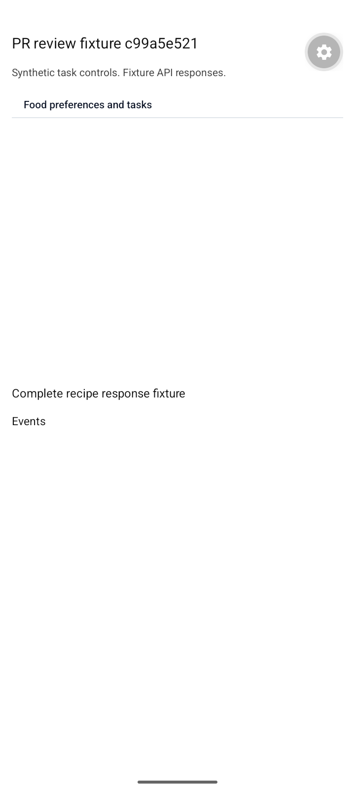
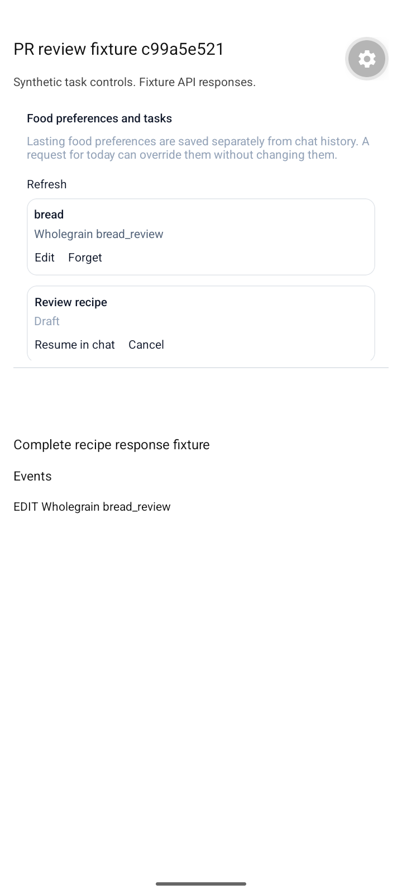
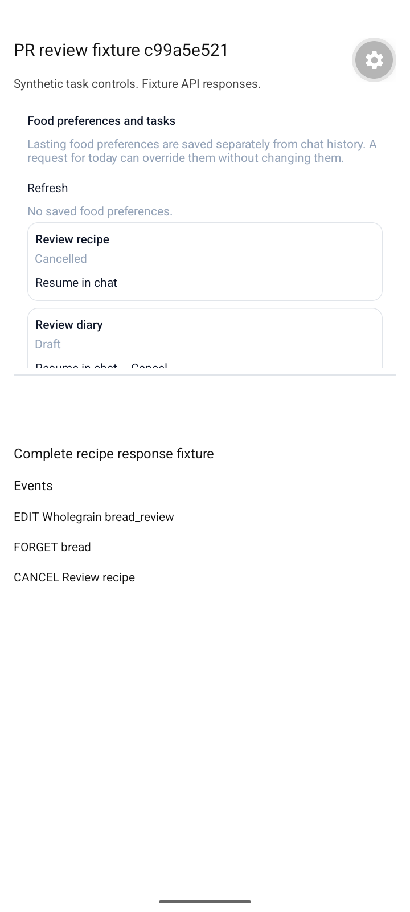
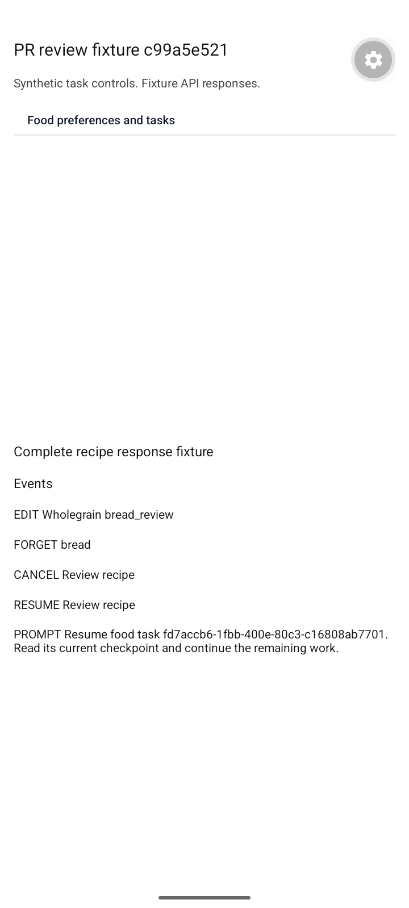
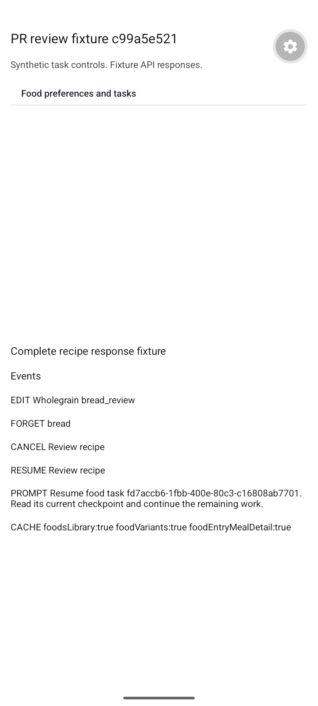
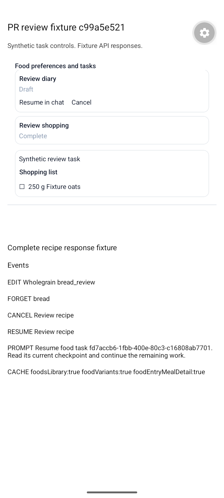
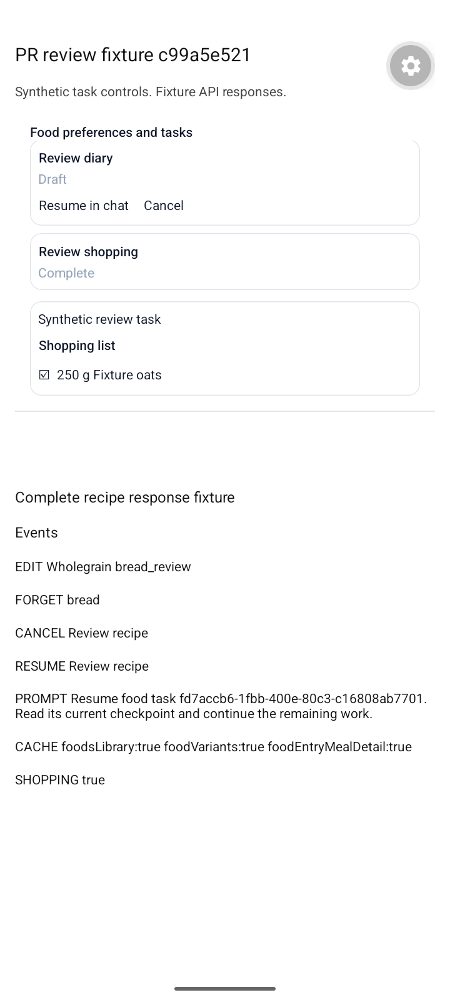
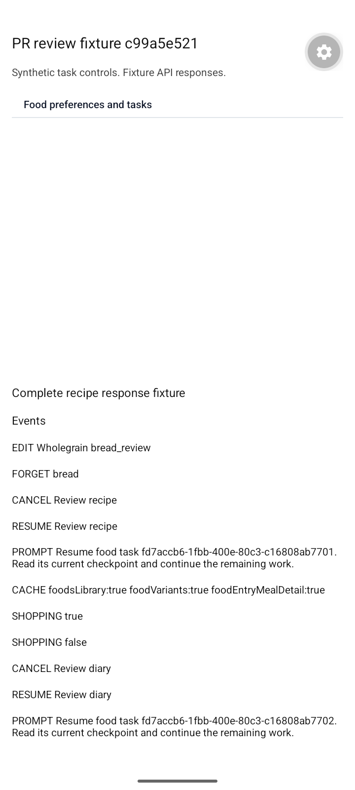

# Android review checks, 2026-10-16

These captures show an isolated Android 15 emulator development build with synthetic fixtures. The application ID is `org.SparkyApps.SparkyFitnessPRReview.dev`. The fixture loads the real `FoodAssistantStatePanel`, `useFoodAssistantState`, assistant-ui local runtime, and `invalidateAssistantFoodCaches`. API responses are in-memory fixtures and network fetches are blocked. This verifies component interactions and cache invalidation; it does not verify authentication, real-server persistence, paid inference, or a production deployment.

The UI source is planning commit `c99a5e521`; its entire mobile tree is unchanged in the subsequent backend-only review fixes. The cache helper is also identical to the recipe increment's implementation. These shared-stack checks supplement the individual branch unit tests.

Verified interactions:

- Open private state, edit/save a preference, and forget it. The fixture event log records the changed value and deletion.
- Cancel recipe and diary tasks. Cancel disappears while Resume remains available. Resume reopens the task and delivers the exact task ID/checkpoint continuation prompt to a local fixture adapter; no provider request is sent.
- Toggle the shopping item purchased and unpurchased, preserving its recorded 250 g quantity. Completed shopping tasks have no Cancel/Resume controls.
- Invoke the actual chat food-cache invalidation helper. Food-library, variant, and meal-detail caches report `isInvalidated: true`.

The fixture entry point and API adapter were temporary test setup and are not application changes. Screenshots are unedited captures of synthetic data.

