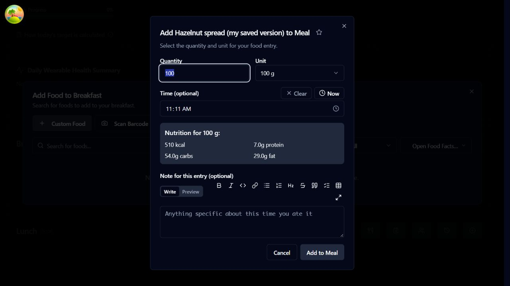
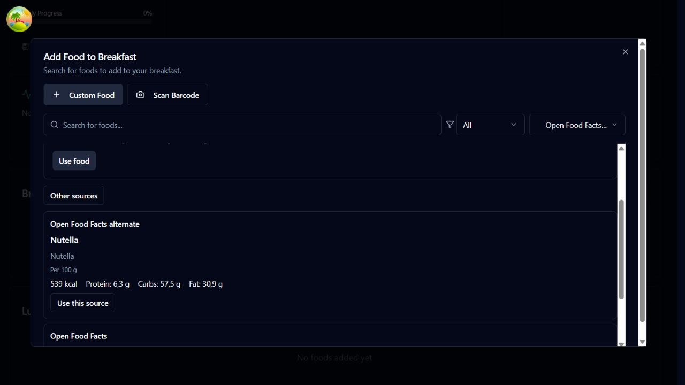
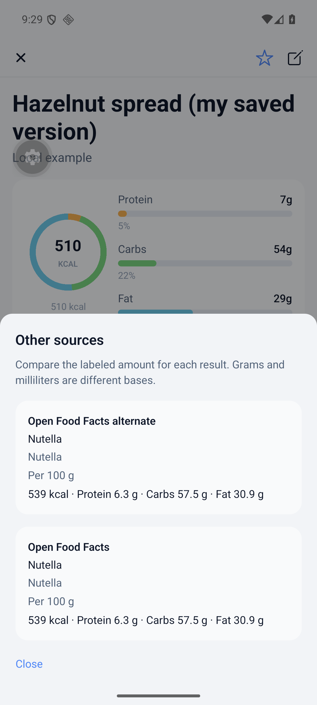

# Food Search

This page will explain how to search for food items in SparkyFitness.
When you click on Add food, you'll have the option to search for recent foods:

You'll also have the option to search for Food online using your configured Food data providers or even scan a Barcode:

## Barcode Sources and Alternatives

A barcode scan first returns a saved local food or the best match from your
existing default provider and Open Food Facts fallback settings.
When several saved foods share the barcode, custom foods come first, followed
by the most recently updated food of the same kind.

If that result is inaccurate, choose **Other sources** to compare matches from
other enabled barcode providers without scanning again. Each result shows its
source, product name, brand, calories, protein, carbohydrates and fat. Known
mass or volume servings are compared per 100 g or 100 ml; other servings keep
their own clearly labelled basis. Missing nutrients are shown as unknown.

Choose a source to use its product in the current add-food flow, then review
and save it normally. Merely viewing alternatives does not import a food.
Saving a different provider product creates a separate library food, even if
another food already has the same barcode. Saving the same provider product
again reuses its existing food.
Provider errors and missing products are shown separately, so one unavailable
source does not hide another provider's match. Changing the source does not
silently replace custom foods or past diary entries.

### Web example

The earlier barcode search showed a single result:

**Other sources** lets you compare that result with matches from other providers:

### Android example

The mobile comparison uses the same source and nutrition details:

